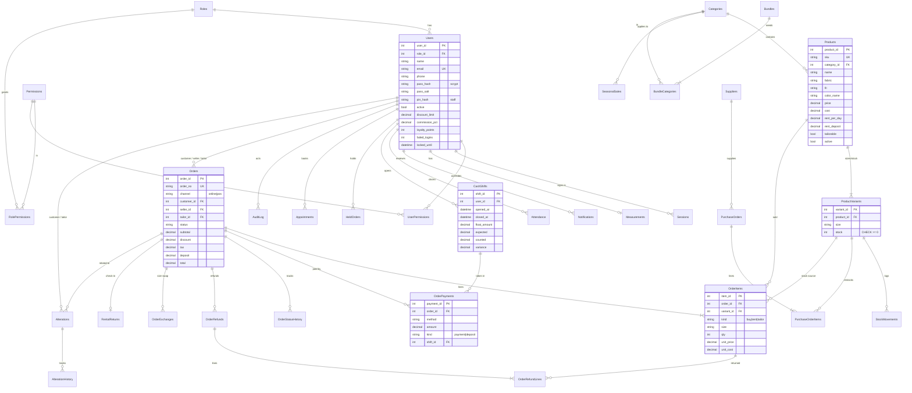

# L'Or de Cambodge - POS & Store Management System

A suit shop system with **three separate views** - **Client** (online shop), **Seller** (cashier / tailor) and **Admin** (owner / manager) - each with its own dashboard and permissions.

**Built with only HTML, CSS and browser JavaScript.** No Node.js, no database server, nothing to install. All data is saved in your browser (localStorage).

---

## 1. Run it

* **Easiest:** double-click `open-site.cmd` (or open `public/login.html` in Chrome / Edge / Firefox).
* **Or serve the folder** with any static host: VS Code "Live Server", GitHub Pages, Netlify, Render "Static Site", etc. Publish the `public/` folder.

On the very first visit the sample data is created in the background (about 2 seconds). Then sign in with one of the accounts below.

### Sample accounts (development)

There is **one sign-in form** (email or phone + password); the system sends you to the right view. Staff can also use the small "Staff: sign in with PIN" link.

| Role | Opens | Email | Password | PIN |
|---|---|---|---|---|
| Client | client.html | client@lordecambodge.com | Client@1234 | - |
| Client (VIP) | client.html | client2@lordecambodge.com | Client@1234 | - |
| Seller (limit 15%, 3% commission) | seller.html | seller@lordecambodge.com | Seller@1234 | 1234 |
| Seller (limit 10%, 2.5%) | seller.html | seller2@lordecambodge.com | Seller@1234 | 2345 |
| Tailor | seller.html | tailor@lordecambodge.com | Tailor@1234 | 3456 |
| Manager | admin.html | manager@lordecambodge.com | Manager@1234 | 4567 |
| Owner / Admin | admin.html | admin@lordecambodge.com | Admin@1234 | 0000 |

More test data and click-through scenarios: [docs/SAMPLE_DATA.md](docs/SAMPLE_DATA.md).

---

## 2. Development vs Production

Set in [`public/js/config.js`](public/js/config.js):

| | `ENV: 'development'` (default) | `ENV: 'production'` |
|---|---|---|
| First visit | Loads the full demo: 7 accounts, 24 products, about 26 orders | Shows **"First-time setup"**: the owner creates the admin account (12+ character password). Empty shop, no demo data |
| Sign-in page | Shows the demo accounts and a yellow **DEV** tag | Shows neither |
| Tests (`tests.html`) | Run | Refuse to run |
| "Reset demo data" button (Admin > Settings) | Available | Hidden |

Each website address (and each browser) keeps its **own separate data**, so a dev copy and a production copy never mix. Publish production with `ENV: 'production'` and keep a dev copy for experiments.

---

## 3. How it works

```text
 Screens (HTML + CSS + JS) --api.get('/api/...')--> js/backend/routes.js   the "API", answered inside the browser
                                                    js/backend/services.js all business rules: pricing, stock, refunds, rentals, shifts
                                                    js/backend/core.js     storage, PBKDF2 password hashing, permissions
                                                    js/backend/seed.js     sample data / first-run setup
                                                    localStorage           the database (key "lodc_db_v3")
```

The screens (`client.js`, `seller.js`, `admin.js`) are written as if they talked to a server. `api()` in `js/lib.js` hands each call to `js/backend/`, which checks it, applies the rules, saves the result and returns JSON. The rules live in one place, so a real server could be put behind the same calls later.

### Roles and permissions
| Role | View | Can do (default) |
|---|---|---|
| client | client.html | Shop, bag, checkout, own orders / measurements / appointments / rentals / tailoring, loyalty, notifications |
| seller | seller.html | POS, orders, refunds & exchanges, customers, alterations, rentals, appointments, stock check, own performance, clock-in & cash shift |
| tailor | seller.html | Alteration tickets, appointments, stock check, view orders, own performance |
| manager | admin.html | Products, inventory & purchasing, promotions, reports, orders, tailoring, rentals, customers, activity log (no staff management or settings) |
| admin | admin.html | Everything, including staff, per-person permission overrides and settings |

Each person can have **permission overrides**, a **discount limit %** and a **commission %**.

### Feature tour
* **Client:** storefront with filters (size, colour, fabric, fit, price), product pages with stock status, bag with promo codes and loyalty points, checkout (KHQR / ABA / card are **simulated**, or pay in store), My measurements, custom tailoring requests, fittings, suit rental with deposit and late fees, order tracking (Pending -> Tailoring -> Ready -> Picked Up / Delivered), loyalty tiers (Member / Silver / Gold / VIP), notifications.
* **Seller:** PIN login, clock-in/out, cash shift, POS (name / SKU / barcode search, sizes, split / deposit / partial payments, hold & resume, receipts), refunds and size exchanges, rentals check-out / check-in, alteration tickets, customer lookup, fittings, stock check, performance & commission, end-of-shift cash report.
* **Admin / manager:** dashboard, products & categories, inventory (adjustments, movements, suppliers, purchase orders), promotions (codes, seasonal sales, bundles, broadcasts), orders, tailoring workload, rentals, customers & VIP levels, staff & permissions, attendance, reports (daily / weekly / monthly, best sellers by size / colour / style, per seller, inventory value, VAT, cash reconciliation, CSV), settings (shop info, logo, VAT, USD/KHR, payment methods, receipt text), **backup & restore**, activity log.

---

## 4. Backup, moving, and what "data in the browser" means

* Data lives only in the browser that created it - **not shared between computers or users.** One cashier PC = one shop database.
* **Back up regularly:** Admin > Settings > *Export backup*. Move to another computer or browser with *Restore from file*.
* Clearing the browser's site data deletes the shop. Back up first.
* Browser storage is limited (about 5 MB). Product photos are shrunk when uploaded, but a very busy shop will eventually need a real server.

## 5. Data model (ERD)

The data is stored as collections (arrays of records) in the browser, with the same names and relationships as the tables below. Diagram (renders on GitHub, VS Code with a Mermaid extension, and mermaid.live):



**Design notes**
* `Orders.total` = subtotal - bundle - discount - points + VAT + rental deposit. The amount paid is the **sum of `OrderPayments`**, so split payments, deposits and later balance payments are all just more rows; `balance = total - paid`.
* Stock is only changed through one function (`moveStock`) that refuses to go below zero and writes a stock-movement record.
* Made-to-measure lines have `variant_id = NULL` (no stock is held).
* Sign-in sessions keep only a SHA-256 of a random token (the token itself stays in the tab's sessionStorage).
* `AuditLog` records who did what, when, and from which IP.

---

## 6. Main screens

| View | Screens |
|---|---|
| **Login** | One form: email-or-phone + password (role detected automatically), staff **PIN** link, client registration, lockout messages |
| **Client** (light storefront with a top menu, like a fashion e-shop) | Home (hero, categories, new arrivals, services) - Shop (filter sidebar: size, color, fabric, fit, price) - Product page (3 pictures, sizes with stock, complete the look) - Shopping bag & checkout - Custom tailoring - Suit rental - Book a fitting - My account (overview, orders, measurements, loyalty & VIP, notifications, profile) |
| **Seller** | Dashboard (shift status, today's numbers) - POS checkout (+ customer picker, size/rent/tailor picker, held orders, receipt) - Orders (+ detail, collect balance, refund/exchange) - Rentals - Alterations - Customers (+ profile & measurements) - Appointments - Stock check - My performance - Shift & cash (end-of-shift report) |
| **Admin** | Dashboard - Products (+ categories) - Inventory (levels, movements, suppliers, purchase orders) - Promotions (codes, sales, bundles, broadcasts) - Orders - Tailoring - Rentals - Customers - Staff (team & permissions, attendance & shifts, commission) - Reports - Activity log - Settings |

---

## 7. Security - please read

Because there is no server, **every check runs in the visitor's browser**:

* Passwords and PINs are stored as salted **PBKDF2-SHA256** hashes (120,000 rounds), never in plain text, and an account locks for 15 minutes after 5 wrong attempts.
* Permissions are enforced by the app: each screen and action checks the signed-in user's role and permissions; discount limits, refund windows, stock and payment rules are enforced in the business-rule layer.
* All text shown on screen is escaped (no raw HTML from data).
* **But:** anyone who can open this browser's developer tools can read or edit the stored data and could bypass these checks. This design suits **one shop computer, a demo or a prototype**. It is **not** secure for real customers on the public internet, because each visitor's browser holds its own separate copy of the data and nothing is shared or protected centrally.
* For a real public shop you need a server and a database (the original Node.js + SQL Server version is archived in `_old-node-version/`).

## 8. Known limits

* **Online payments are simulated** (KHQR, ABA Pay, card): orders are marked paid, no gateway is called, no card details are collected.
* Google sign-in, email and SMS are not connected (receipts open your email app through a `mailto:` link).
* Product pictures are generated drawings unless you upload a photo (Admin > Products > Edit).
* Needs a modern browser (Chrome, Edge, Firefox, Safari) with JavaScript and localStorage enabled. Secure password hashing needs the page to be opened from `https://`, `http://localhost` or `file://` (a browser rule for Web Crypto).

## 9. Tests

Open `public/tests.html` (development only). It resets the demo data, runs **89 checks** (permissions, pricing, bundles, stock, refunds, exchanges, rentals, shifts, lockout, staff rules, backups...) and resets the data again. Every line should say `ok`.

## 10. Files

```text
public/
  login.html, script.js, style.css       sign-in, registration, first-run setup
  client.html  seller.html  admin.html   the three views
  css/app.css, css/client.css            styles (client.css = light storefront)
  js/config.js                           ENV: 'development' | 'production'
  js/backend/core.js services.js routes.js seed.js    the browser-side "server"
  js/lib.js common.js client.js seller.js admin.js    the screens
  js/tests.js, tests.html                in-browser tests
  three.min.js, gent3d.js, intro.js      the animated 3D greeting on the sign-in page
docs/SAMPLE_DATA.md                      accounts, products, test scenarios
open-site.cmd                            opens the site
_old-node-version/                       archived Node.js + SQL Server version
```
